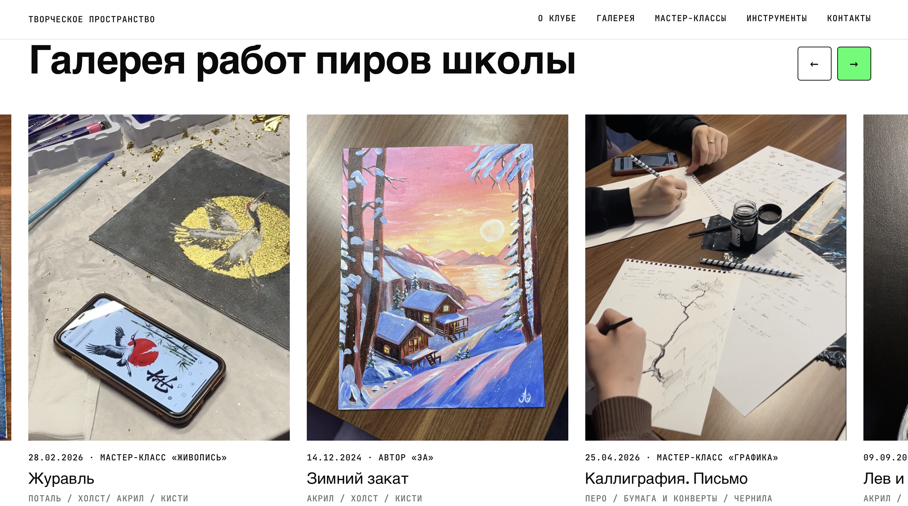

**Творческий клуб для программистов**

Одностраничный сайт творческого пространства, где люди, пишущие код, могут развивать креативность, цветовосприятие и пространственное мышление. Клуб проводит занятия по живописи, графике, скульптуре и декоративно-прикладному искусству. Каждое занятие завершается готовой работой, которую можно забрать домой.

GitHub Pages

**Ссылка: https://enaenaenahm.github.io/my_art_web/**

**О проекте**

Сайт выполняет роль визитной карточки творческого клуба и содержит:

**О клубе**— правила участия, периодичность занятий, направления творчества.
**Галерея работ** — примеры студенческих работ (включая работы руководителя с пометкой «ЭА»).


**Мастер-классы** — информация о проводимых мероприятиях.
**Инструменты и материалы** — что предоставляется участникам.
**Контакты** — ссылка на Telegram и платформу Школы 21, адрес проведения занятий.Технологии

Проект представляет собой статический HTML-сайт. В репозитории присутствуют:

index.html — основная страница сайта.
img/ — папка с изображениями (вероятно, работы из галереи и оформление).

 Структура репозитория

```
my_art_web/
├── img/
└── index.html
```
